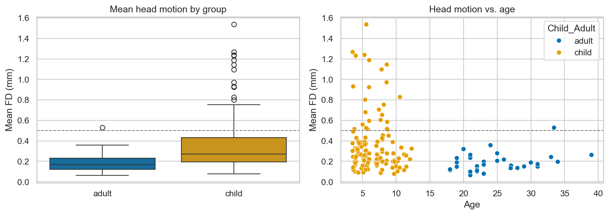
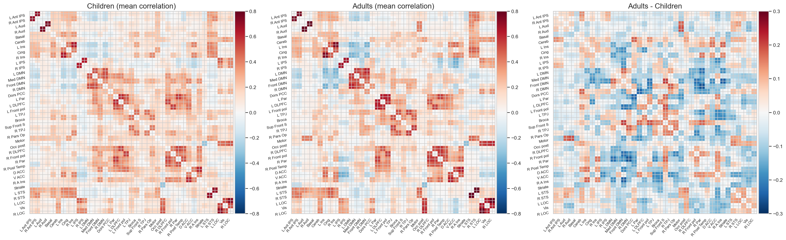
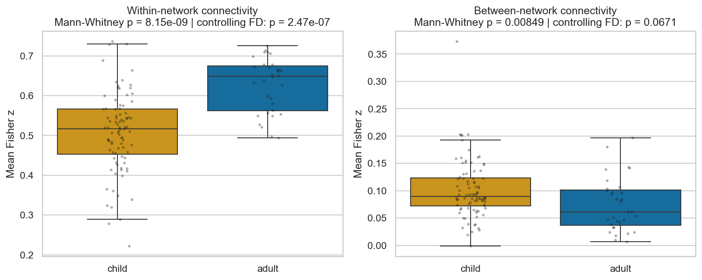
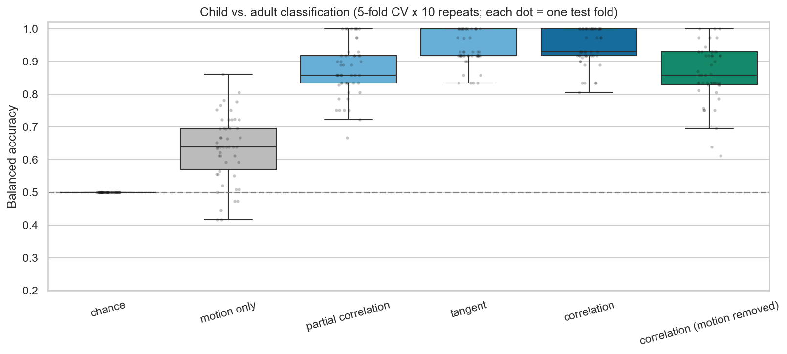
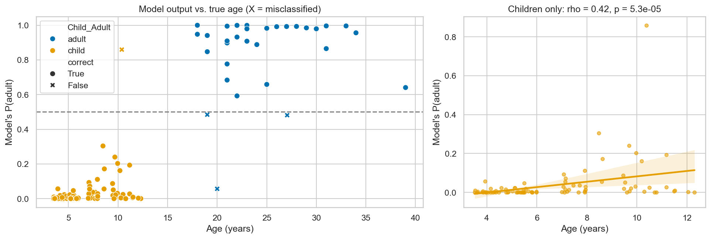

# Developmental Neuroimaging: How Brain Networks Reorganise from Childhood to Adulthood

Can we tell a child's brain from an adult's just by looking at how its regions communicate? And if so, what exactly changes?

This project analyses fMRI data from **120 participants (88 children aged 3–12, 32 adults)** watching the same short film. It builds a **functional connectivity** fingerprint for each person and uses it to (1) describe how brain networks differ between children and adults and (2) train a classifier that separates the two groups, while controlling carefully for head motion, the main confound in developmental fMRI.

**Key results**
- A simple linear model separates children from adults with **94.5% balanced accuracy** (chance = 50%, permutation p ≈ 0.001).
- This is **not explained by head motion**: motion alone gives 63.5%, and accuracy remains **86.2%** after motion is regressed out of every connection.
- With age, brain networks become **more internally cohesive** (p < 10⁻⁶, robust to motion), and the default mode network decouples from salience and attention systems.
- The classic "local → distributed" distance effect is **not** reproduced once motion is controlled.
- The model's output works like a **brain-maturity score**: within children it rises with age (ρ = 0.42), although the model never saw anyone's age.

---

## 1. Project overview

```
Brain_Network_Development_fMRI/
├── README.md
├── notebooks/
│   ├── 01_dataset_exploration.ipynb   data, sample, head-motion QC, exclusion, region signals
│   ├── 02_exploratory_analysis.ipynb  connectivity matrices, network-level differences (H2)
│   ├── 03_model_development.ipynb     child-vs-adult classifiers, baselines, motion control (H1, H3)
│   └── 04_error_analysis.ipynb        who is misclassified, maturity score, stable connections
├── src/
│   ├── preprocessing.py               loading, motion metrics, confounds, time-series extraction
│   ├── feature_extraction.py          atlas, connectivity matrices, network summaries
│   └── evaluation.py                  cross-validation, baselines, permutation test, weight stability
├── results/
│   ├── figures/                       all figures, generated by the notebooks
│   └── model_evaluation.md            full model results and error tables
├── requirements.txt
└── LICENSE
```

Each notebook starts with its goal and ends with a summary table. Reusable code lives in `src/` so the notebooks stay short and readable.

## 2. Research motivation

Childhood is a period of major brain reorganisation. Studies from the late 2000s suggested that brain networks shift from being organised by **physical proximity** (nearby regions talk to each other) to being organised by **function** (distant regions working together) (Fair et al., 2009). Others showed that connectivity alone could predict an individual's brain maturity (Dosenbach et al., 2010).

Soon after, it became clear that **head motion**, which is much larger in children, produces exactly the kind of connectivity differences that had been attributed to development (Power et al., 2012; Satterthwaite et al., 2013). So any developmental claim needs to show that it is **not just motion**. This project revisits these questions on a modern, openly available dataset with motion controlled at every step.

## 3. Dataset and original paper

**Richardson, H., Lisandrelli, G., Riobueno-Naylor, A., & Saxe, R. (2018).** *Development of the social brain from age three to twelve years.* Nature Communications, 9, 1027.

- 155 participants (122 children aged 3.5–12.3 y; 33 adults aged 18–39 y) watched the 5.6-minute Pixar short *Partly Cloudy* during fMRI.
- Raw data: [OpenNeuro ds000228](https://openneuro.org/datasets/ds000228). We use the **fMRIPrep-preprocessed, downsampled** version distributed by nilearn (`nilearn.datasets.fetch_development_fmri`): 4 mm voxels, 168 volumes, TR = 2 s, MNI space.
- The original paper studied *theory-of-mind* and *pain* networks during the film. Here we use the same data for a different question: **whole-brain network organisation**.

## 4. Research questions

**Main question:** Do the brain's functional networks reorganise between childhood (3–12 y) and adulthood?

| | Hypothesis | Tested in |
|---|---|---|
| **H1** | Connectivity patterns differ enough to classify individuals as child or adult. | Notebook 03 |
| **H2** | With development, organisation shifts from local to distributed: regions within a network become more tightly linked, and networks become more distinct. | Notebook 02 |
| **H3** | These differences are not just explained by children moving more in the scanner. | Notebooks 01–04 |

## 5. Methodology

| Step | What | Why |
|---|---|---|
| **Motion QC** | Framewise displacement (FD); exclude if mean FD > 0.5 mm or > 20% of volumes with FD > 0.5 mm (rules fixed before analysis) | Motion creates false correlations; children move more |
| **Regions** | MSDL probabilistic atlas, 39 regions in 17 networks | Network labels make results interpretable; 741 features suits ~120 people |
| **Denoising** | 6 motion parameters, white matter, CSF, 5 aCompCor components; detrend; band-pass 0.01–0.1 Hz; no global signal regression | Removes motion, physiological noise and drift without forcing artificial anti-correlations |
| **Connectivity** | Pearson correlation between all region pairs (also partial correlation and tangent); Fisher-z for averaging | Standard measures; Fisher-z makes averaging valid |
| **Group comparison** | Within- vs. between-network connectivity; regression with mean FD as covariate; connection length vs. change | Direct tests of H2, with motion control |
| **Classification** | Standardise → logistic regression (balanced class weights); stratified 5-fold CV × 10 repeats; balanced accuracy | Simple, interpretable; robust to the 3 : 1 group imbalance |
| **Controls for H3** | Motion-only baseline; mean FD regressed out of every connection *inside* each training fold; 1,000-shuffle permutation test | Shows the result is neither motion nor chance |
| **Error analysis** | Out-of-fold predictions per person; P(adult) vs. age within children (partial correlation controlling for FD); weight stability across folds | Shows where the model fails and what it relies on |

All steps that learn from data (tangent reference, scaling, motion regression, classifier) are fitted on training folds only to avoid leakage.

## 6. Results

### Children move more, so motion has to be controlled

Children moved significantly more than adults (median FD 0.27 vs. 0.17 mm, p = 8 × 10⁻⁶). The exclusion rule removed **28% of children but only 3% of adults**, leaving 88 children and 32 adults. Excluded and kept children were the same age (p = 0.90), but children still moved slightly more after exclusion (p = 0.002), so motion is controlled again in every later analysis.



### Adults have stronger connections within networks and weaker ones between them

Both groups share the same overall network layout. In adults, the blocks along the diagonal (within-network connections) are stronger and most connections between networks are weaker. The clearest specific change is the **default mode network decoupling from salience and attention regions**.



Summarised per person, **within-network connectivity is much higher in adults** (p = 8 × 10⁻⁹; p = 2 × 10⁻⁷ controlling for motion). Between-network connectivity is lower in adults (p = 0.008), but that is only a trend once motion is controlled (p = 0.067).



Connection **length** does not predict developmental change (ρ = −0.04, p = 0.31; see `results/figures/02_distance_effect.png`). Network membership does.

→ **H2 partly supported:** networks become more cohesive and somewhat more distinct, but the distance-based "local → distributed" shift is not found.

### Connectivity classifies children vs. adults with high accuracy, beyond motion

| Model | Balanced accuracy |
|---|---|
| Chance | 0.500 |
| Motion only | 0.635 ± 0.100 |
| Partial correlation | 0.875 ± 0.082 |
| Tangent | 0.937 ± 0.051 |
| **Correlation** | **0.945 ± 0.055** |
| Correlation, motion regressed out | 0.862 ± 0.085 |



→ **H1 supported** (permutation p ≈ 0.001). **H3 supported:** motion alone does far worse, and removing motion from the features keeps accuracy high. Full details are in [`results/model_evaluation.md`](results/model_evaluation.md).

### Errors happen at the age boundary, and the model tracks maturity

Only **4 of 120** people are misclassified: a 10.4-year-old child (one of the oldest) and three adults, two of them the youngest (19 and 20 y). Among children, the model's P(adult) **rises with age** (ρ = 0.42, p = 5 × 10⁻⁵), and this holds after controlling for motion (ρ = 0.40). Connectivity matures gradually; most 12-year-olds are still far from adult-like, so much of the change probably happens in adolescence.



The model's most stable features: **adult-like** inter-hemispheric insula and STS links and cerebellar–cortical links; **child-like** language–salience (Broca's area ↔ ACC/insula) and salience–DMN links (`results/figures/04_model_weights.png`).

## 7. Limitations

- **No adolescents.** The sample jumps from 12 to 18 years, so we compare two groups instead of tracing a developmental curve, and the classification task is relatively easy.
- **Unbalanced, motion-filtered sample.** There are 3 children for every adult, and 28% of children were excluded for motion. The remaining children are likely calmer than typical, which may limit generalisation.
- **Movie watching, not rest.** Connectivity was measured while participants watched a film, and children and adults may attend to it differently. Some differences could reflect *how* they watched rather than intrinsic organisation.
- **Residual motion.** Children still moved slightly more after exclusion. We controlled for this statistically, but no method removes motion effects completely.
- **Coarse atlas.** 39 large regions keep the feature count manageable but hide fine-grained and very short-range changes, which may partly explain the null distance result.
- **Single dataset, low temporal resolution.** 168 volumes per person limit how precisely connectivity (especially partial correlation) can be estimated, and there is no external test set.
- **Weights ≠ causes.** Connections are correlated with each other, so model weights describe patterns, not causal mechanisms.

## 8. How to reproduce the analysis

```bash
git clone https://github.com/Leena2403/Brain_Network_Development_fMRI.git
cd Brain_Network_Development_fMRI
python -m venv .venv && source .venv/bin/activate      # Windows: .venv\Scripts\activate
pip install -r requirements.txt
jupyter notebook notebooks/
```

Run the notebooks **in order** (01 → 04):

1. **01** downloads the dataset (~900 MB, saved to `~/nilearn_data`) and the atlas, then saves cleaned region signals to `data/` (a few minutes).
2. **02** and **03** load those signals. Notebook 03 runs 200 cross-validated models plus a 1,000-shuffle permutation test (~5 minutes on a laptop).
3. **04** uses the predictions saved by notebook 03.

All figures are written to `results/figures/`. Random seeds are fixed, so the numbers should match this README.

**On Google Colab:** clone the repo in a cell, `%cd Brain_Network_Development_fMRI/notebooks`, then `!pip install -q -r ../requirements.txt` Each Colab notebook runs on its own machine, so notebooks 02–04 rebuild the files they need in `data/` if they're missing (this adds a few minutes).

## 9. References

- Behzadi, Y., Restom, K., Liau, J., & Liu, T. T. (2007). A component based noise correction method (CompCor) for BOLD and perfusion based fMRI. *NeuroImage*, 37(1), 90–101.
- Dosenbach, N. U. F., et al. (2010). Prediction of individual brain maturity using fMRI. *Science*, 329(5997), 1358–1361.
- Esteban, O., et al. (2019). fMRIPrep: a robust preprocessing pipeline for functional MRI. *Nature Methods*, 16, 111–116.
- Fair, D. A., et al. (2008). The maturing architecture of the brain's default network. *PNAS*, 105(10), 4028–4032.
- Fair, D. A., et al. (2009). Functional brain networks develop from a "local to distributed" organization. *PLoS Computational Biology*, 5(5), e1000381.
- Abraham, A., et al. (2014). Machine learning for neuroimaging with scikit-learn. *Frontiers in Neuroinformatics*, 8, 14. (nilearn)
- Pedregosa, F., et al. (2011). Scikit-learn: Machine learning in Python. *JMLR*, 12, 2825–2830.
- Power, J. D., Barnes, K. A., Snyder, A. Z., Schlaggar, B. L., & Petersen, S. E. (2012). Spurious but systematic correlations in functional connectivity MRI networks arise from subject motion. *NeuroImage*, 59(3), 2142–2154.
- Richardson, H., Lisandrelli, G., Riobueno-Naylor, A., & Saxe, R. (2018). Development of the social brain from age three to twelve years. *Nature Communications*, 9, 1027.
- Satterthwaite, T. D., et al. (2013). An improved framework for confound regression and filtering for control of motion artifact in the preprocessing of resting-state functional connectivity data. *NeuroImage*, 64, 240–256.
- Varoquaux, G., Baronnet, F., Kleinschmidt, A., Fillard, P., & Thirion, B. (2010). Detection of brain functional-connectivity difference in post-stroke patients using group-level covariance modeling. *MICCAI 2010*.
- Varoquaux, G., Gramfort, A., Pedregosa, F., Michel, V., & Thirion, B. (2011). Multi-subject dictionary learning to segment an atlas of brain spontaneous activity. *IPMI 2011*.

## About

Felt like looking at some neuroscience dataset and understand brain imaging... Got to learn a lot about human brain regions working on this :)

## License

MIT. See [LICENSE](LICENSE).
